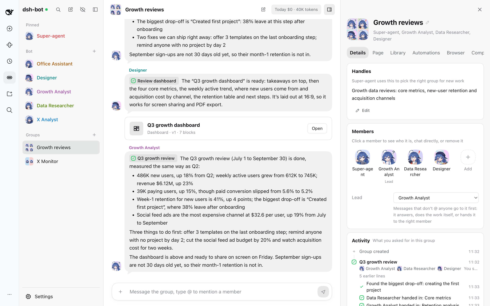
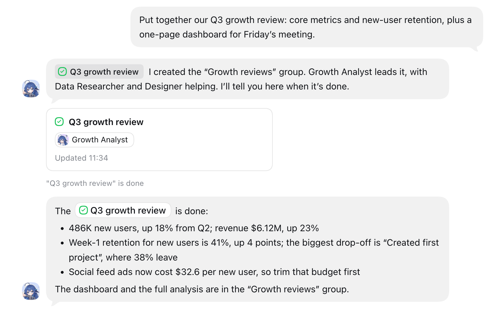
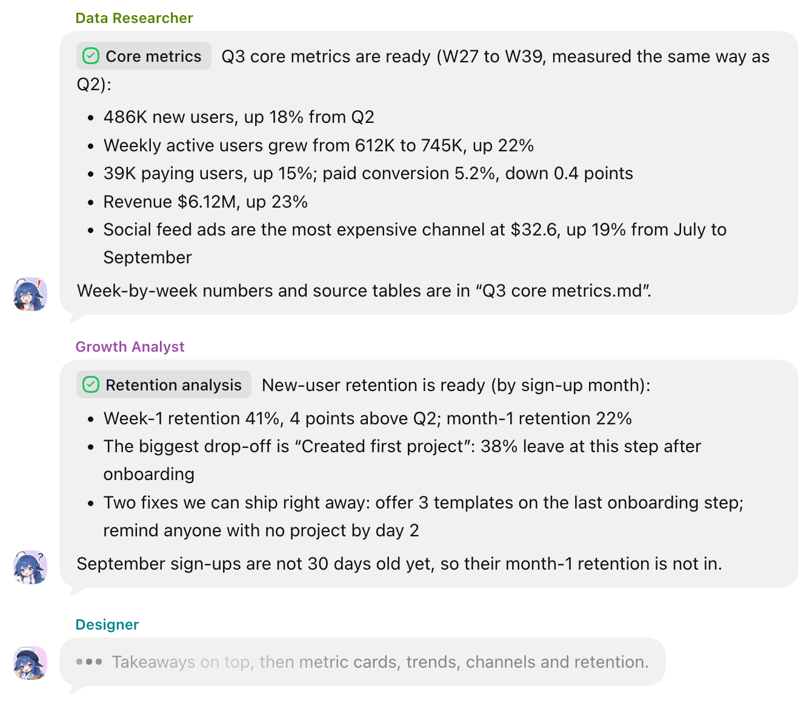
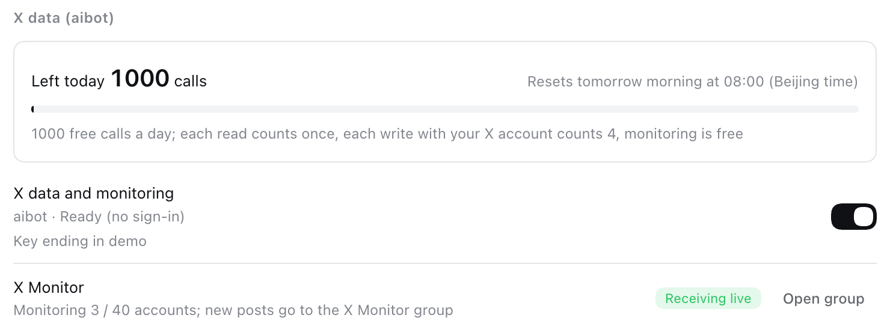
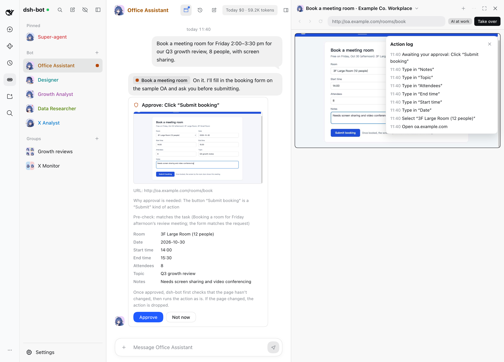
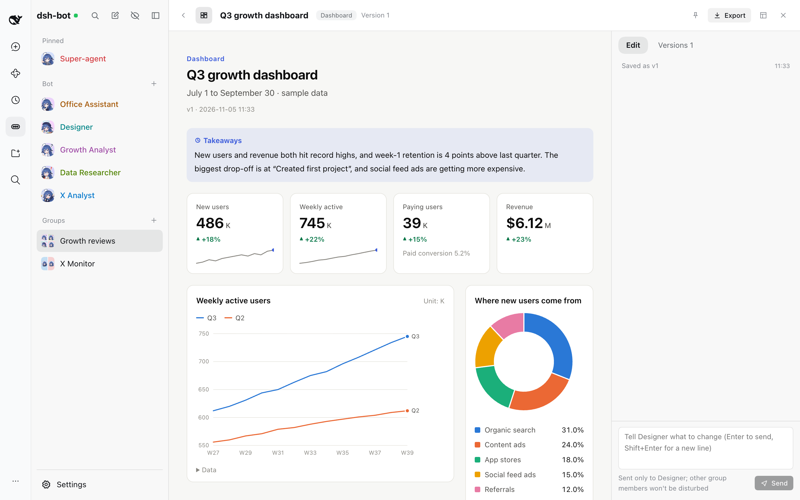
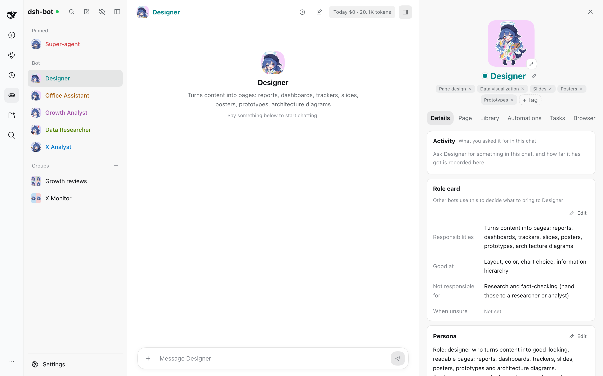
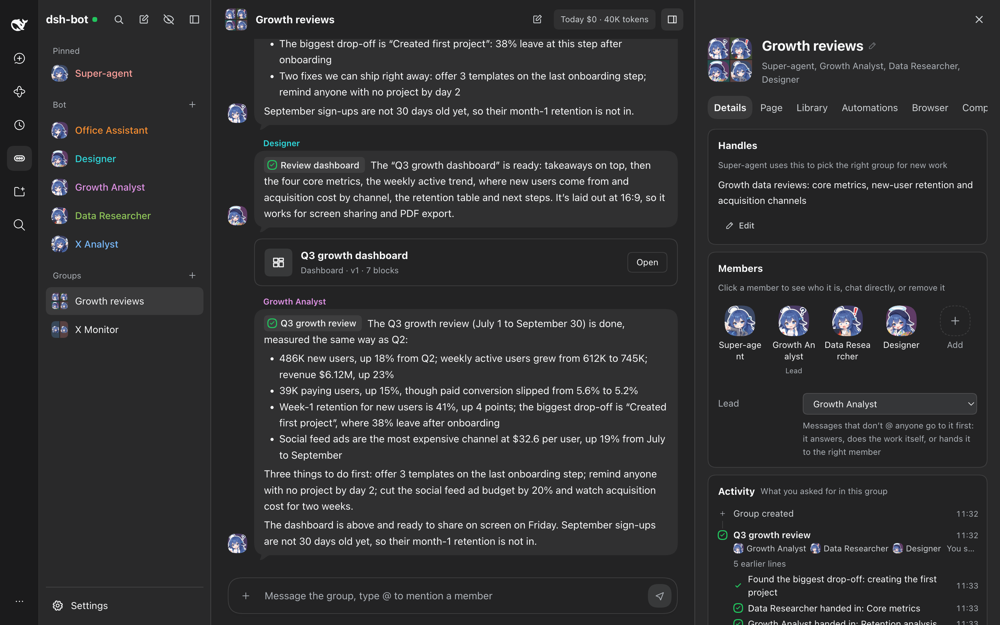

<div align="center">


# dsh-bot

English | [中文](README.md)

dsh-bot is a bot plugin for [DeepSeek Harness](https://github.com/deepseek-ai/deepseek-harness) (dsh for short) that turns dsh into a crew of bots. You tell the Super-agent what you need; it hands the work to the right group, where several bots split it up.

1000 free X data API calls a day

[](https://www.npmjs.com/package/@aibot_fans/dsh-bot)    [](LICENSE)

[Install](#install) · [Features](#features) · [Usage (Chinese)](docs/USAGE.md) · [Development (Chinese)](docs/DEVELOPMENT.md) · [License](#license)

</div>



<p align="center"><sub>Screenshots show sample data from a demo.</sub></p>

## Highlights

### 1000 free X data API calls a day

[aibot](https://aibot.fans/) is set up automatically on first launch: no sign-up, no sign-in, no key to paste. Bots can look up X (Twitter) users, tweets, search and trends right away, with **1000 free calls a day** (each read counts once; the quota resets at 8:00 Beijing time, 00:00 UTC). You can also **monitor 40 accounts for free**: monitoring doesn't use up calls, and new posts arrive in real time in the “X Monitor” group.

### Tell the Super-agent; the work happens in groups

You only tell the Super-agent what you need. If a few sentences will do, it answers on the spot; if there's work to do, it hands it to the right group: the group's lead takes it and splits it among the members by what each one handles, independent parts run at the same time, and every result is posted in the group. If no group fits, the Super-agent creates one for the topic and writes down what it handles, so similar work goes there next time. When the work is done, the Super-agent tells you the conclusion in the main chat.

## Features

### Tell the Super-agent; the work happens in groups



- The main chat is just you and the Super-agent. Small talk, progress questions and things it remembers get an answer on the spot. For research, running commands or writing something long, it opens a task: work it can do itself happens in the main chat, and work for other bots goes into a group.
- Each group has one line saying what it handles. The Super-agent uses it to pick the right group; if none fits, it creates a new group for the topic, makes the responsible bot its lead and writes down what it handles. Name a group and the work goes there; a bot you ask for that isn't in the group is added first.
- In a group, messages that don't @ anyone go to the lead first: it answers what takes a few sentences and hands the rest to members by what each one handles. A member you @ takes it directly. The Super-agent only speaks in a group when it's @-mentioned or quoted, and handles organizational things such as adding members, creating bots and changing the lead.
- Members work at the same time and post their results in the group; the lead reviews each one and merges them into one complete answer, and the Super-agent then tells you the conclusion in the main chat.
- Group details are on the right, open by default on wide screens: what the group handles (editable), members and lead (changeable), and activity (who is working on what, the progress they logged, and who handed in what).
- Routines, the daily brief and scheduled wake-ups are all triggers on tasks: at a time (once, or repeating on a cron schedule), when another task finishes, or when a watched web page changes, the task wakes up and carries on. Routines live in groups too, and each run's results are posted there.



### Chats and tasks

- Chats use bubbles, yours on the right and bots' on the left. While a bot is answering, a gray bubble at the bottom of the chat shows the step it's on; when several bots answer at once, each gets its own.
- Things waiting for you are cards: on a question card, click an option to answer, write your own answer or skip; an approval card spells out what will happen, and you choose Approve or Not now.
- A task opened in the main chat comes with a task card. Click it to see the task details on the right: overview, progress, brief, result and subtasks; unfinished tasks can be paused, resumed or stopped.
- “Stop answering” stops what's going on in this chat: a task stops only this run and stays open, and picks up again when you say something or when its time comes.
- Each row in the left list shows a status on the right: a spinner while working, an orange dot when waiting for you, a red cross when it failed, and a green check when it's done but not yet seen. Each section is sorted by latest message; dragging is only for pinning and moving into folders.
- The right side of the top bar shows today's usage: for this bot in a direct chat, for this group in a group; click it for a breakdown. Drag the right edge of the chat area to change the chat width; double-click to go back to the default.

### 1000 free X data API calls a day

- [aibot](https://aibot.fans/) is set up automatically on first launch, with no sign-up or sign-in. The install code and key are stored only in your local `pod.db`.
- Bots can look up X (Twitter) users, tweets, search and trends: 1000 free calls a day, each read counts once, and the quota resets at 8:00 Beijing time (00:00 UTC).
- Account monitoring: 40 accounts for free, and monitoring doesn't use up calls. New posts arrive in real time in the “X Monitor” group with a notification, and anything missed while offline is fetched automatically. To watch someone, tell the X Analyst in that group “monitor @handle”.
- Settings → Usage shows how many calls are left today and how many accounts are monitored, and lets you turn the whole thing off. Running out of quota, being rate-limited and a disabled device each come with an explanation.
- Quotas and [rules](https://aibot.fans/x-api/rest) are set by [aibot](https://aibot.fans/).
- Bots can also use your own X account: once you sign in to X in dsh-bot's browser, they can look up posts, users, timelines, search, follower lists, notifications, bookmarks and DMs, read encrypted chats, and post, reply, quote, delete posts, like, repost, bookmark, pin, follow, block and mute. Posts can carry images, GIFs and video (up to 4 files from the workspace). Anything that changes something follows the x.com rule in the browser's site rules: with no rule, nothing is sent until you have seen the endpoint, parameters and files on an approval card and approved it; in Settings → Browser you can set x.com to no approval needed (for common actions such as posting, liking and following only), read-only or blocked.



### Shared browser

Bots can use the web like a person: open pages, read them, click, fill in forms, upload files, take screenshots and pull out the main text. All bots share one headless Chrome and one set of logins, so once a site is signed in, every bot can use it. Chrome runs with dsh-bot's own profile and never touches the one you use every day.

- While a bot is using the browser, a browser button appears in the chat's top bar. Open it to watch the live screen on the right; the “…” menu has the action log and closes tabs. Click “Take over” to drive it yourself, then hand it back to the bot. For sites that need a login, take over and sign in yourself.
- Write actions such as submit, send, delete, buy and confirm need your approval. The approval card shows a screenshot of the page, the URL and what was filled in, plus a pre-check that judges whether this step is what you asked for, so page content can't lead a bot astray. Once you approve, dsh-bot first confirms the page hasn't changed, then carries out the action exactly as shown.
- Bots fill in the usernames, passwords and verification codes you give them. They never enter card or ID numbers, and on the page they only see that a card field is filled.
- Local and LAN addresses are blocked by default; add the ones you really need to the allowlist in Settings → Browser. Concurrency and request rate are limited per site to avoid tripping anti-bot checks.
- Triggers that watch web pages, and exporting pages to PDF and long images, use it too.



### Computer use (macOS 14 or later)

Once you turn it on in Settings → Computer use, bots working on tasks can use other apps on this Mac in the background: read windows, click buttons and type, without taking over your mouse and keyboard.

- Each task asks you before it uses an app for the first time; browsers, terminals, System Settings and script apps are off-limits. Turning it off revokes every permission.
- While a bot is using the computer, a computer button appears in the chat's top bar. Open it to see the app windows the bot is using; you can take over and hand back at any time.
- The helper needs the Accessibility and Screen Recording permissions in System Settings; the settings page has a button to grant them and a check. macOS 14 or later only.

### Pages (Grok Pages)

Bots can turn reports, dashboards, trackers, slides, posters, prototypes and architecture diagrams into pages. They only fill in component data (metrics, charts, tables, flowcharts, architecture diagrams, timelines, heatmaps, kanban boards, progress and more); dsh-bot takes care of layout, colors and dark mode.

- Pages render in a sandbox with no network access.
- Type the changes you want in the panel on the right; they go only to the bot that made the page. Every save is a new version, and you can restore an old one at any time.
- Export to PDF, a long PNG or a single HTML file. Routines can refresh the same page on a schedule.



### 30 built-in character icons

- 30 whale-girl icons, matched automatically by name and role: a data researcher, a designer and an analyst each get their own look.
- Each name gets a random color that stays readable on light and dark backgrounds, used in the sidebar, groups and messages.
- Bot details let you change the name, avatar, tags, role card, persona, model, thinking level and tool profile. You can also see the bot's activity, memory, skills, growth log and version history.



### And more

- **Autonomous by default**: bots make their own calls and keep going. They only come to you in four cases: a login or verification code is needed, an irreversible external action is next, a safety rule blocks something, or there's an ambiguity with no sensible default that would change the result a lot. Missing details are filled in with sensible defaults, and the assumptions are written down.
- **@ mentions**: @ a member in a group to call on them directly; bots call on each other too. @names in messages show the bot's icon; click one to see its details.
- **How bots work**: Settings → How bots work lets you pause processing (starting work and sending messages wait, and messages are still recorded), set how much autonomy bots get, and limit how many tasks run at once; however many tasks are running, what you say never waits in line.
- **Memory and search**: your profile, bot experience, group conventions and group memory. Say “remember …” to save something directly; key points are also picked out of conversations automatically. Every night memory is tidied into topic notes; every change keeps its source and a whole night can be undone. Global search uses a character-level index built for Chinese text.
- **Long conversations**: when the context reaches the rollover length (Settings → Model), the conversation continues in a new segment, bridged by a handover note; tasks also check before starting work.
- **Automations and notifications**: Settings → Automations lists the daily brief and every bot's and group's automations, where you can turn them on and off, filter and create new ones. Runs missed while dsh web was closed catch up once the next time it opens; with DeepSeek models, runs can move to off-peak hours; watching a web page makes no model call when nothing changed. There's also a notification center, browser notifications and quiet hours.
- **Self-improvement**: thumbs up and down, your corrections, the lead's reviews and edits to handed-in files all count as feedback. Task retrospectives turn into experience and skills, personas and reasoning levels are tuned from feedback, changes that make things worse are rolled back automatically, and a weekly “This week's changes” card sums it up. Undo a bad adjustment in the growth log, or go back to any earlier setup in version history. Only skills that include scripts need your approval.
- **Safety**: only you can give instructions; a bot gets only the permissions every applicable rule allows; a task that has read web pages is treated as tainted, and all its write actions need approval; per-site rules and a default blocklist; local and LAN addresses blocked by default; checks on data leaving your machine; secrets masked in the audit log; terminal and browser write actions disabled while dsh web is open to the network; one click to stop all tasks; an append-only audit log.
- **Dark mode**: both the app and pages have dark versions.
- **English and Chinese**: Settings → General → Language. It follows dsh's display language by default. In English, the interface, system messages, default bots and bot replies are all in English.

<details>
<summary>Dark mode screenshot</summary>



</details>

## Install

Requires dsh 0.2.1-rc.2 or later (below 0.3.0), Node 24 and pnpm (`dsh plugin` installs plugins with pnpm). The shared browser needs Chrome on your machine (Edge, Chromium or Brave work too); computer use needs macOS 14 or later.

Install it into the dsh web you normally use (the `web` profile):

```bash
dsh plugin --profile web add @aibot_fans/dsh-bot
```

Then restart dsh web (stop it first if it's already running) and open the address it prints:

```bash
dsh web
```

“dsh-bot” appears in the sidebar. The first time you open it, a short guide walks you through it; after that, just tell the Super-agent what you need in the main chat. Bots use the models configured in dsh: change the default model in dsh-bot's Settings → Model, or pick one per bot in its details. The language follows dsh's display language; to change it, go to Settings → General → Language.

To install from source or work on the code, see the [development guide](docs/DEVELOPMENT.md) (Chinese).

## Upgrade

When a new version is out, “x.y.z available” appears next to Settings at the bottom of the dsh-bot sidebar; click it to see what changed in each version. If you installed from npm, just click “Update to x.y.z”: dsh-bot asks dsh's plugin manager to remove the old version and install the new one. Bots, conversations and tasks live in the data directory and aren't affected.

- With hot reload on in dsh web (the default), the new version is running as soon as it's installed, with no restart, and the page returns to dsh-bot by itself. With hot reload off, restart dsh web after the install to switch over; until then, a banner at the top of the page reminds you.
- If the new version fails to install (for example, with no network), the previous version is reinstalled automatically.
- By default pnpm only installs versions that have been published for at least a day (to avoid freshly published, poisoned packages), so a brand-new version can be updated with one click the next day; the dialog shows when.
- If bots are busy, updating interrupts them, so you're asked first; unfinished tasks pick up again once the new version is running.
- Installs from source (`link:`) can't be updated with one click; the dialog explains how to update.
- Settings → Advanced lets you check now or turn off automatic checks.

You can also upgrade from the command line:

```bash
dsh plugin --profile web add @aibot_fans/dsh-bot@latest
```

Then restart dsh web.

- Coming from `ds-pod` (the old name): run `dsh plugin --profile web remove ds-pod` first, then install `@aibot_fans/dsh-bot` as above. Your data stays in `~/.dsh/pod`; no migration needed.
- The database schema is migrated automatically at startup. dsh-bot backs up its database once a day and keeps the latest 7 backups.
- After a restart, refresh any dsh-bot tabs you already had open: an old page may call APIs that have changed. When a page notices its version differs from the backend, it shows a banner asking you to refresh.

## Uninstall

```bash
dsh plugin --profile web remove @aibot_fans/dsh-bot
```

Uninstalling doesn't delete your data; remove the directories below yourself.

## Where your data lives

| Location | Contents |
|---|---|
| `~/.dsh/pod/pod.db` | Bots, conversations, tasks, memory, pages and settings, plus the [aibot](https://aibot.fans/) install code and key |
| `~/.dsh/pod/search.db` | The global search index |
| `~/.dsh/pod/backups/` | One database backup per day; the latest 7 are kept |
| `~/.dsh/pod/browser/` | The shared browser's profile, including site logins |
| `~/Pod/` | Workspace: direct chats (`bots/`), groups (`rooms/`), task working files (`tasks/`, `teams/`) and final outputs (`shared/`); uploaded attachments are in their own folders too |

If `DSH_HOME` is set, `~/.dsh` becomes `$DSH_HOME`.

## Privacy

- Everything stays local: dsh-bot runs inside the dsh web process, data lives only in the directories above, and model requests go to the model services configured in dsh.
- X account: when a bot uses the X account you signed in to in dsh-bot's browser, dsh-bot opens an x.com tab in the shared browser that isn't shown in the panel, and closes it after 10 idle minutes. The sign-in state is stored in `~/.dsh/pod/browser/`, like any other site's.
- Computer use: the helper runs only on this computer, and dsh-bot talks to it over a local socket.
- Update checks: one minute after startup and every 6 hours after that, dsh-bot asks the official npm registry (`registry.npmjs.org`, or the China mirror `registry.npmmirror.com` if that can't be reached) which versions of `@aibot_fans/dsh-bot` exist. The request contains only the package name. To turn this off, go to Settings → Advanced and switch off “Check for new versions automatically”.

## Development

The [development guide](docs/DEVELOPMENT.md) (Chinese) covers the directory layout, building, trying things in an isolated dsh environment (without touching `~/.dsh`, using a scripted model), releasing, the API for other plugins, and implementation notes. The screenshots in this README were also produced in the isolated environment with demo scripts.

## Acknowledgements

- [DeepSeek Harness](https://github.com/deepseek-ai/deepseek-harness): dsh-bot is a dsh plugin; bots run on dsh sessions and use dsh's models and tools.
- The built-in icons are whale-girl images based on the character from [lmy414/ai-chan-sheets](https://github.com/lmy414/ai-chan-sheets), originally by ZipZipPipe.
- X data and monitoring are provided by [aibot](https://aibot.fans/).
- [aibot-x-post](https://www.npmjs.com/package/aibot-x-post), which dsh-bot uses to read and write X, contains code adapted from [fa0311/twitter_api_safe_relay](https://github.com/fa0311/twitter_api_safe_relay) (MIT). X responses are filtered with [jq](https://github.com/jqlang/jq) from [jq-wasm](https://github.com/owenthereal/jq-wasm) (MIT).
- The computer use helper is built unmodified from the macOS source of [Comma](https://github.com/AFK-surf/Comma).

## License

- The code is open source under the [Apache License 2.0](LICENSE), provided “as is”, without warranty of any kind.
- The whale-girl icons (`packages/runtime/assets/bot-icons/`) are adapted from [lmy414/ai-chan-sheets](https://github.com/lmy414/ai-chan-sheets) and licensed under [CC BY-NC-SA 4.0](https://creativecommons.org/licenses/by-nc-sa/4.0/), not the Apache License 2.0: non-commercial use only, with attribution, and adaptations must be shared under the same license. The screenshots in `docs/images/` (including `docs/images/en/`) contain these icons and are under the same license.
- [aibot-x-post](https://www.npmjs.com/package/aibot-x-post), bundled in the host plugin to read and write X, is not open source and not under the Apache License 2.0; it may only be used as part of dsh-bot.
- The computer use helper (source in `vendor/comma-computer-use/`) comes from Comma and is licensed under the [GNU AGPL v3.0](vendor/comma-computer-use/LICENSE), not the Apache License 2.0; it is a separate program, and dsh-bot only talks to it over a local socket.
- To use dsh-bot commercially, replace these icons first. See [NOTICE](NOTICE) for third-party material.

## Disclaimer

- dsh-bot is an independent community project. It is **not an official DeepSeek product** and is not endorsed or sponsored by DeepSeek. DeepSeek, DeepSeek Harness, X, Twitter, Grok, Chrome and others are names or trademarks of their respective owners, mentioned here only to describe what dsh-bot works with.
- When using X data and monitoring, follow [aibot](https://aibot.fans/)'s [rules](https://aibot.fans/x-api/rest), X's rules and local laws. Don't use them to harass or track people.
- You are responsible for what bots do with your X account (posting, liking, following, reading DMs…). X frowns on frequent automated actions: check the endpoint and parameters before approving, and don't spam.
- The shared browser operates web pages on your computer on your behalf, and with computer use bots operate other apps on your Mac; you are responsible for what bots do. Follow each site's terms of use, and read the approval card carefully before approving a write action.
- Bots use the models you configured in dsh and spend your own quota. They read and write files in the workspace and run commands as you ask. Their answers and deliverables are generated by models and may be wrong; verify anything important yourself.
