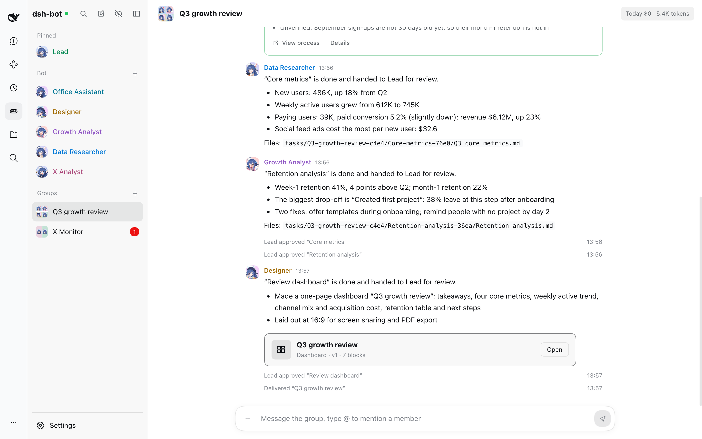
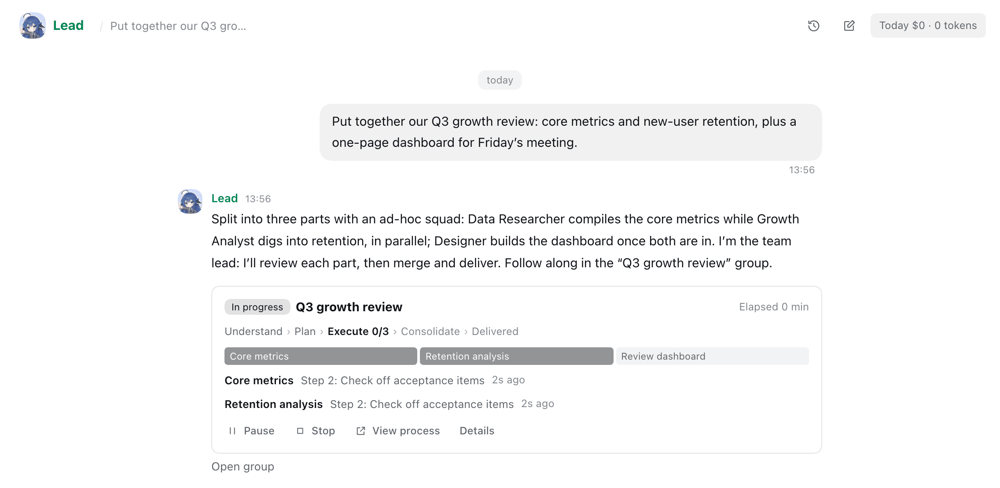
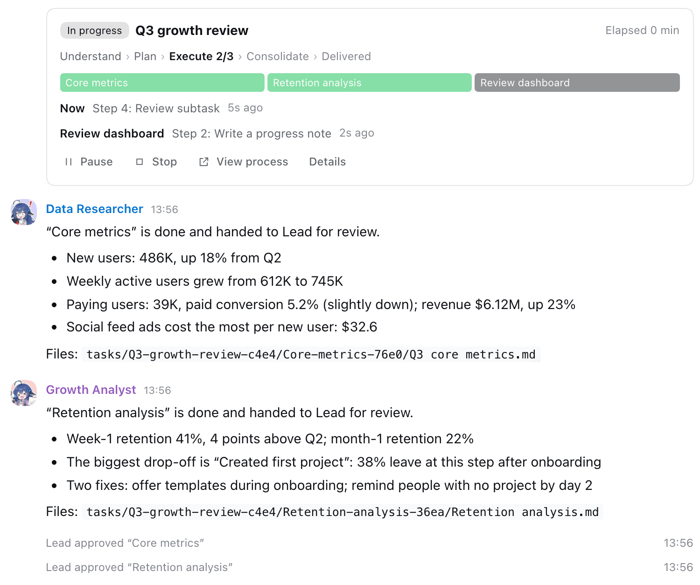
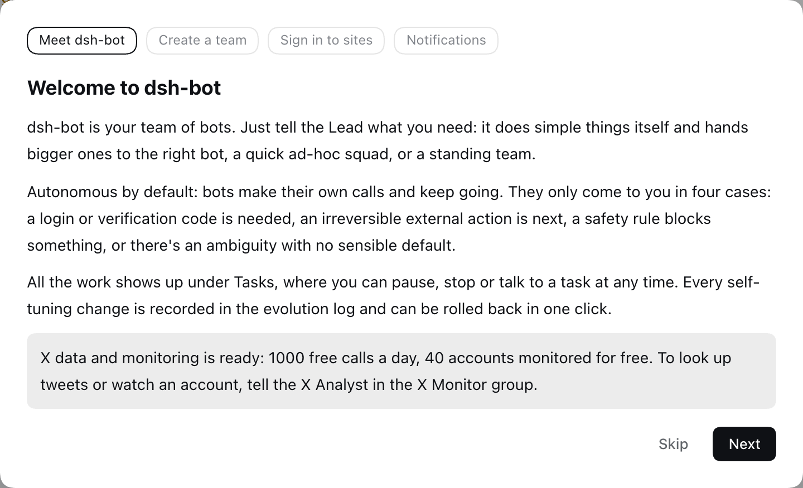
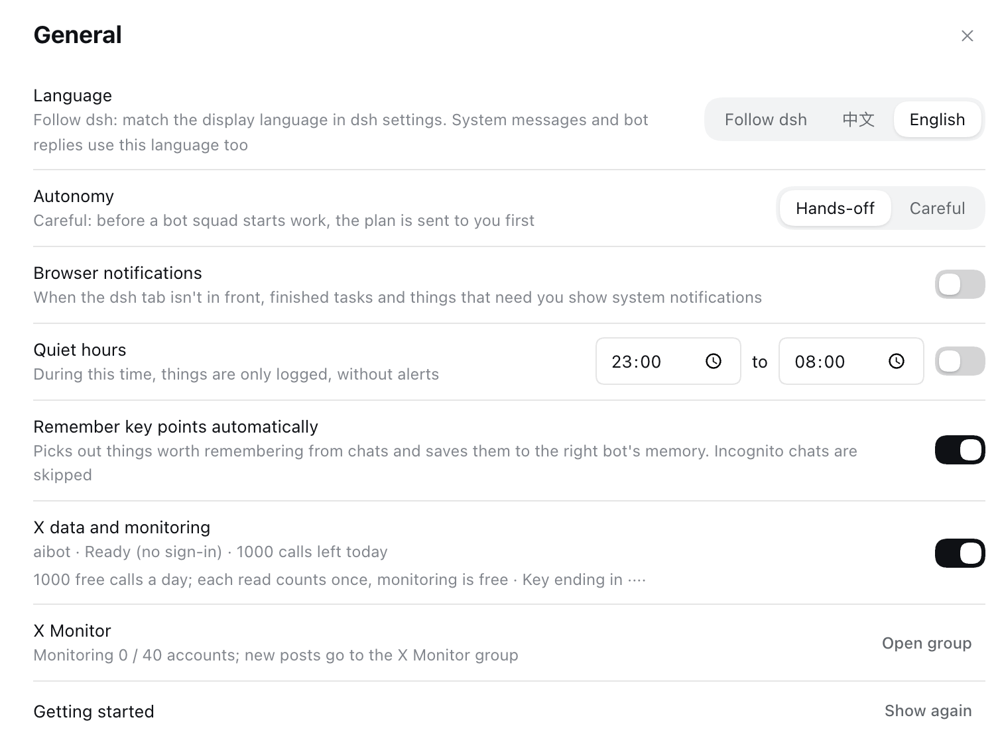
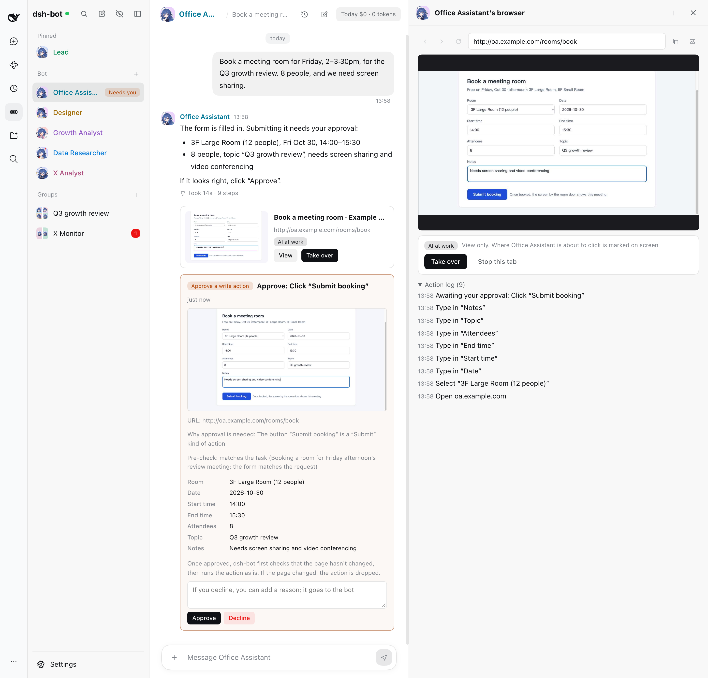
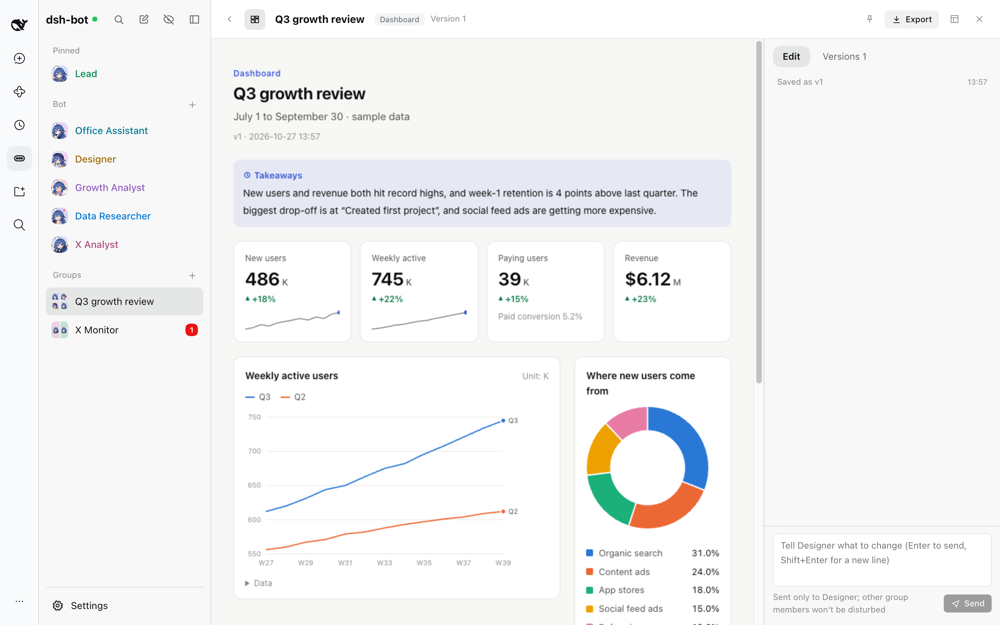
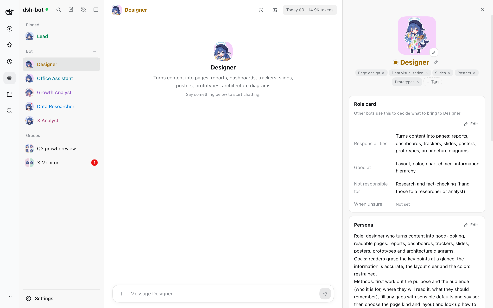
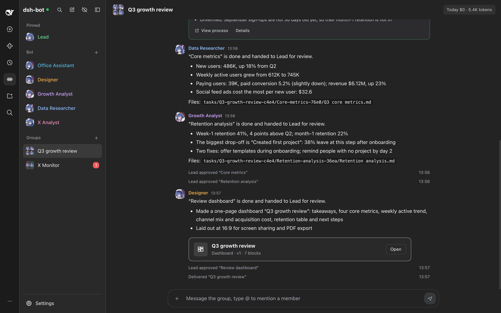

<div align="center">


# dsh-bot

English | [中文](README.md)

dsh-bot is a bot plugin for [DeepSeek Harness](https://github.com/deepseek-ai/deepseek-harness) (dsh for short) that turns dsh into a crew of bots. Every task is a team.

1000 free X data API calls a day

[](https://www.npmjs.com/package/@aibot_fans/dsh-bot)    [](LICENSE)

[Install](#install) · [Features](#features) · [Usage (Chinese)](docs/USAGE.md) · [Development (Chinese)](docs/DEVELOPMENT.md) · [License](#license)

</div>



<p align="center"><sub>Screenshots show sample data from a demo.</sub></p>

## Highlights

### 1000 free X data API calls a day

[aibot](https://aibot.fans/) is set up automatically on first launch: no sign-up, no sign-in, no key to paste. Bots can look up X (Twitter) users, tweets, search and trends right away, with **1000 free calls a day** (each read counts once; the quota resets at 8:00 Beijing time, 00:00 UTC). You can also **monitor 40 accounts for free**: monitoring doesn't use up calls, and new posts arrive in real time in the “X Monitor” group.

### Every task is a team

You only talk to the Lead. It handles simple things itself; for bigger ones it forms a squad on the spot: it splits the work into subtasks, gives each one to the bot with the right skills, and runs independent parts in parallel. Each task gets its own group, and the task card shows live who is doing what. The team lead reviews each part, sends back what doesn't pass, merges the results and hands you a delivery card: key points, files, assumptions and open questions.

## Features

### Every task is a team

Tell the Lead what you need and it decides how to handle it: do it itself (L0), hand it to one bot (L1), form an ad-hoc squad with the Lead as team lead (L2), or hand it to a standing team run by its team lead (L3).



- Plans are checked before work starts. Who does what, the assumptions, the task conventions and why the work was split this way go into a kickoff note posted in the task's group.
- Subtasks are scheduled by their dependencies, and independent ones run at the same time. The task card updates in place: stage, a segmented progress bar, what each member is doing right now, and cost.
- The team lead reviews each part and sends back what doesn't pass. When a member gets stuck, the work gets a new approach, a different bot or smaller pieces. When requirements change, a new version of the plan comes out and only the affected parts are redone.
- Once everything passes, the results are merged and the task card turns into a delivery card: key points, files (click to preview), assumptions and open questions. At any point you can pause, stop or resume the task, or talk to it directly.



### 1000 free X data API calls a day

- [aibot](https://aibot.fans/) is set up automatically on first launch, with no sign-up or sign-in. The install code and key are stored only in your local `pod.db`.
- Bots can look up X (Twitter) users, tweets, search and trends: 1000 free calls a day, each read counts once, and the quota resets at 8:00 Beijing time (00:00 UTC).
- Account monitoring: 40 accounts for free, and monitoring doesn't use up calls. New posts arrive in real time in the “X Monitor” group with a notification, and anything missed while offline is fetched automatically. To watch someone, tell the X Analyst in that group “monitor @handle”.
- Settings → General shows how many calls are left today and how many accounts are monitored, and lets you turn the whole thing off. Running out of quota, being rate-limited and a disabled device each come with an explanation.
- Quotas and [rules](https://aibot.fans/x-api/rest) are set by [aibot](https://aibot.fans/).

<p>


</p>

### Shared browser

Bots can use the web like a person: open pages, read them, click, fill in forms, upload files, take screenshots and pull out the main text. All bots share one headless Chrome and one set of logins, so once a site is signed in, every bot can use it. Chrome runs with dsh-bot's own profile and never touches the one you use every day.

- When a bot opens a page, a browser card shows up in the chat. Click “View” to watch the live screen and action log on the right; click “Take over” to drive it yourself, then hand it back to the bot. For sites that need a login, take over and sign in yourself.
- Write actions such as submit, send, delete, buy and confirm need your approval. The approval card shows a screenshot of the page, the URL and what was filled in, plus a pre-check that judges whether this step is what you asked for, so page content can't lead a bot astray. Once you approve, dsh-bot first confirms the page hasn't changed, then carries out the action exactly as shown.
- Bots never fill in passwords, verification codes or card numbers. If you enter them while you've taken over, bots only see that the field is filled, both on the page and on approval cards.
- Local and LAN addresses are blocked by default; add the ones you really need to the allowlist in Settings → Browser. Concurrency and request rate are limited per site to avoid tripping anti-bot checks.
- Routines that watch web pages, and exporting pages to PDF and long images, use it too.



### Pages (Grok Pages)

Bots can turn reports, dashboards, trackers, slides, posters, prototypes and architecture diagrams into pages. They only fill in component data (metrics, charts, tables, flowcharts, architecture diagrams, timelines, heatmaps, kanban boards, progress and more); dsh-bot takes care of layout, colors and dark mode.

- Pages render in a sandbox with no network access.
- Type the changes you want in the panel on the right; they go only to the bot that made the page. Every save is a new version, and you can restore an old one at any time.
- Export to PDF, a long PNG or a single HTML file. Routines can refresh the same page on a schedule.



### 30+ built-in character icons

- 30 whale-girl icons, matched automatically by name and role: a data researcher, a designer and an analyst each get their own look.
- Each name gets a random color that stays readable on light and dark backgrounds, used in the sidebar, groups and messages.
- Bot details let you change every setting: name, role, avatar, capability tags, role card, persona, model, thinking level and tool profile. You can also see the bot's memory, skills, growth log and version history.



### And more

- **Autonomous by default**: bots make their own calls and keep going. They only come to you in four cases: a login or verification code is needed, an irreversible external action is next, a safety rule blocks something, or there's an ambiguity with no sensible default. Whatever can be worked around is worked around first, and the delivery lists the assumptions and open questions.
- **Groups**: @ a member in a group to call on them directly; bots call on each other too. @names in messages show the bot's icon; click one to see its details.
- **Memory and search**: your profile, bot experience, team conventions, group conventions and group memory. Say “remember …” to save something directly; key points are also picked out of conversations automatically. Global search uses a character-level index built for Chinese text.
- **Long conversations**: when the context nears its soft limit, the conversation continues in a new segment, bridged by a handover note.
- **Routines and notifications**: scheduled routines (cron, catch-up runs, off-peak scheduling), web page watching (no model call when nothing changed), a daily brief, a notification center with browser notifications, and quiet hours.
- **Self-improvement**: thumbs up and down, your corrections, the team lead's reviews and edits after delivery all count as feedback. Task retrospectives turn into experience and skills, personas and reasoning levels are tuned from feedback, changes that make things worse are rolled back automatically, and a weekly “This week's changes” card sums it up. Undo a bad adjustment in the growth log, or go back to any earlier setup in version history. Only skills that include scripts need your approval.
- **Safety**: only you can give instructions; a bot gets only the permissions every applicable rule allows; a task that has read web pages is treated as tainted, and all its write actions need approval; per-site rules and a default blocklist; local and LAN addresses blocked by default; checks on data leaving your machine; secrets masked; terminal and browser write actions disabled while dsh web is open to the network; one-click stop; an append-only audit log.
- **Dark mode**: both the app and pages have dark versions.
- **English and Chinese**: Settings → General → Language. It follows dsh's display language by default. In English, the interface, system messages, default bots and bot replies are all in English.

<details>
<summary>Dark mode screenshot</summary>



</details>

## Install

Requires dsh 0.2.1-rc.2 or later (below 0.3.0), Node 24 and pnpm (`dsh plugin` installs plugins with pnpm). The shared browser needs Chrome on your machine (Edge, Chromium or Brave work too).

Install it into the dsh web you normally use (the `web` profile):

```bash
dsh plugin --profile web add @aibot_fans/dsh-bot
```

Then restart dsh web (stop it first if it's already running) and open the address it prints:

```bash
dsh web
```

“dsh-bot” appears in the sidebar. The first time you open it, a short guide walks you through it; after that, just tell the Lead what you need. Bots use the models configured in dsh: change the default model in dsh-bot's Settings → Model, or pick one per bot in its details. The language follows dsh's display language; to change it, go to Settings → General → Language.

To install from source or work on the code, see the [development guide](docs/DEVELOPMENT.md) (Chinese).

## Upgrade

When a new version is out, “x.y.z available” appears next to Settings at the bottom of the dsh-bot sidebar; click it to see what changed in each version (release notes are written in Chinese for now). If you installed from npm, just click “Update to x.y.z”: dsh-bot asks dsh's plugin manager to remove the old version and install the new one. Bots, conversations and tasks live in the data directory and aren't affected.

- With hot reload on in dsh web (the default), the new version is running as soon as it's installed, with no restart, and the page returns to dsh-bot by itself. With hot reload off, restart dsh web after the install to switch over; until then, a banner at the top of the page reminds you.
- If the new version fails to install (for example, with no network), the previous version is reinstalled automatically.
- By default pnpm only installs versions that have been published for at least a day (to avoid freshly published, poisoned packages), so a brand-new version can be updated with one click the next day; the dialog shows when.
- If bots are busy, updating interrupts them, so you're asked first; unfinished tasks pick up again once the new version is running.
- Installs from source (`link:`) can't be updated with one click; the dialog explains how to update.
- Settings → Advanced lets you check now or turn off automatic checks.

You can also upgrade from the command line:

```bash
dsh plugin --profile web add @aibot_fans/dsh-bot@latest
```

Then restart dsh web.

- Coming from `ds-pod` (the old name): run `dsh plugin --profile web remove ds-pod` first, then install `@aibot_fans/dsh-bot` as above. Your data stays in `~/.dsh/pod`; no migration needed.
- The database schema is migrated automatically at startup. dsh-bot backs up its database once a day and keeps the latest 7 backups.
- After a restart, refresh any dsh-bot tabs you already had open: an old page may call APIs that have changed. When a page notices its version differs from the backend, it shows a banner asking you to refresh.

## Uninstall

```bash
dsh plugin --profile web remove @aibot_fans/dsh-bot
```

Uninstalling doesn't delete your data; remove the directories below yourself.

## Where your data lives

| Location | Contents |
|---|---|
| `~/.dsh/pod/pod.db` | Bots, conversations, tasks, memory, pages and settings, plus the [aibot](https://aibot.fans/) install code and key |
| `~/.dsh/pod/search.db` | The global search index |
| `~/.dsh/pod/backups/` | One database backup per day; the latest 7 are kept |
| `~/.dsh/pod/browser/` | The shared browser's profile, including site logins |
| `~/Pod/` | Workspace: direct chats (`bots/`), groups (`rooms/`), task working files (`tasks/`, `teams/`) and final outputs (`shared/`); uploaded attachments are in their own folders too |

If `DSH_HOME` is set, `~/.dsh` becomes `$DSH_HOME`.

## Privacy

- Everything stays local: dsh-bot runs inside the dsh web process, data lives only in the directories above, and model requests go to the model services configured in dsh.
- Update checks: one minute after startup and every 6 hours after that, dsh-bot asks the official npm registry (`registry.npmjs.org`, or the China mirror `registry.npmmirror.com` if that can't be reached) which versions of `@aibot_fans/dsh-bot` exist. The request contains only the package name. To turn this off, go to Settings → Advanced and switch off “Check for new versions automatically”.

## Development

The [development guide](docs/DEVELOPMENT.md) (Chinese) covers the directory layout, building, trying things in an isolated dsh environment (without touching `~/.dsh`, using a scripted model), releasing, the API for other plugins, and implementation notes. The screenshots in this README were also produced in the isolated environment with demo scripts.

## Acknowledgements

- [DeepSeek Harness](https://github.com/deepseek-ai/deepseek-harness): dsh-bot is a dsh plugin; bots run on dsh sessions and use dsh's models and tools.
- The built-in icons are whale-girl images based on the character from [lmy414/ai-chan-sheets](https://github.com/lmy414/ai-chan-sheets), originally by ZipZipPipe.
- X data and monitoring are provided by [aibot](https://aibot.fans/).

## License

- The code is open source under the [Apache License 2.0](LICENSE), provided “as is”, without warranty of any kind.
- The whale-girl icons (`packages/runtime/assets/bot-icons/`) are adapted from [lmy414/ai-chan-sheets](https://github.com/lmy414/ai-chan-sheets) and licensed under [CC BY-NC-SA 4.0](https://creativecommons.org/licenses/by-nc-sa/4.0/), not the Apache License 2.0: non-commercial use only, with attribution, and adaptations must be shared under the same license. The screenshots in `docs/images/` (including `docs/images/en/`) contain these icons and are under the same license.
- To use dsh-bot commercially, replace these icons first. See [NOTICE](NOTICE) for third-party material.

## Disclaimer

- dsh-bot is an independent community project. It is **not an official DeepSeek product** and is not endorsed or sponsored by DeepSeek. DeepSeek, DeepSeek Harness, X, Twitter, Grok, Chrome and others are names or trademarks of their respective owners, mentioned here only to describe what dsh-bot works with.
- When using X data and monitoring, follow [aibot](https://aibot.fans/)'s [rules](https://aibot.fans/x-api/rest), X's rules and local laws. Don't use them to harass or track people.
- The shared browser operates web pages on your computer on your behalf, and you are responsible for what bots do on websites. Follow each site's terms of use, and read the approval card carefully before approving a write action.
- Bots use the models you configured in dsh and spend your own quota. They read and write files in the workspace and run commands as you ask. Their answers and deliverables are generated by models and may be wrong; verify anything important yourself.
