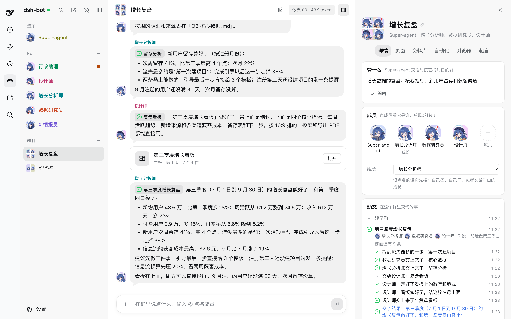
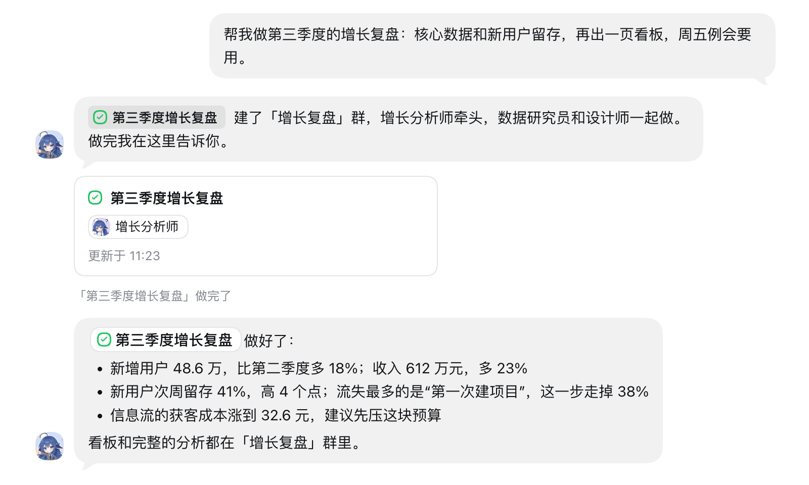
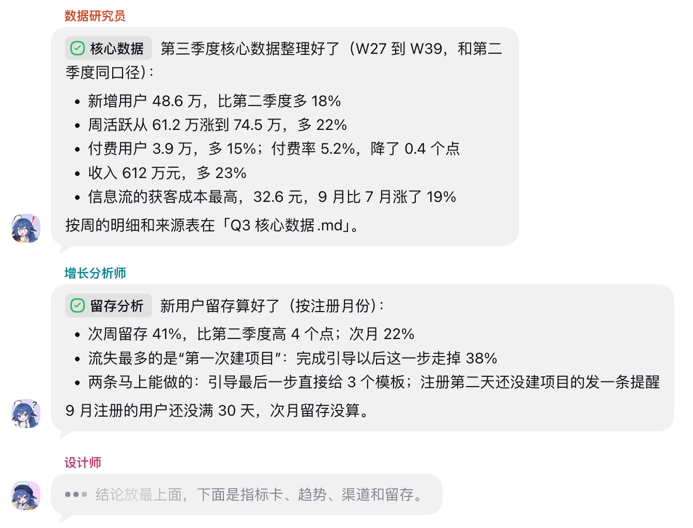
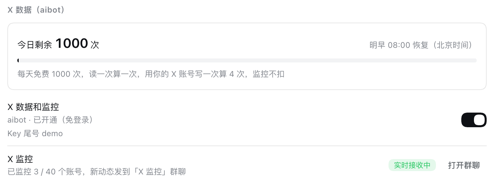
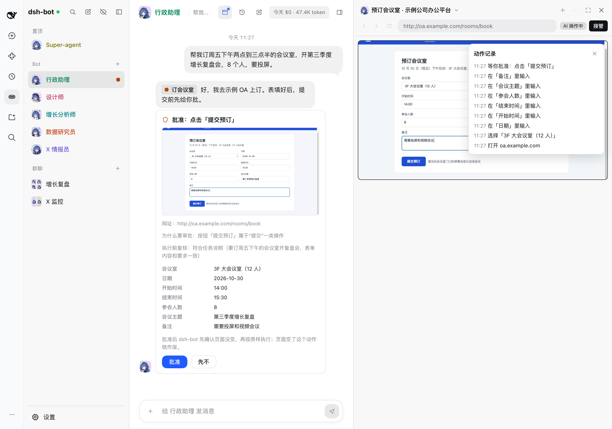
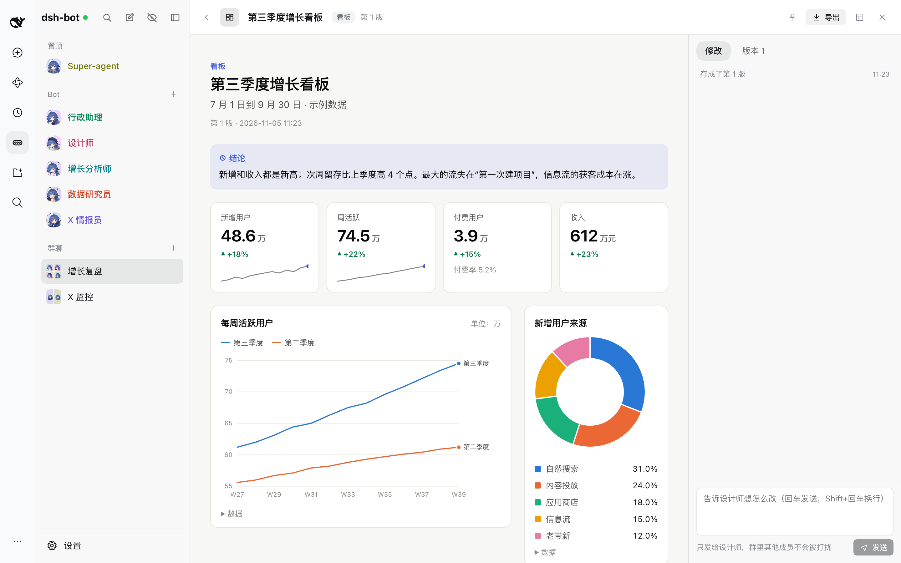
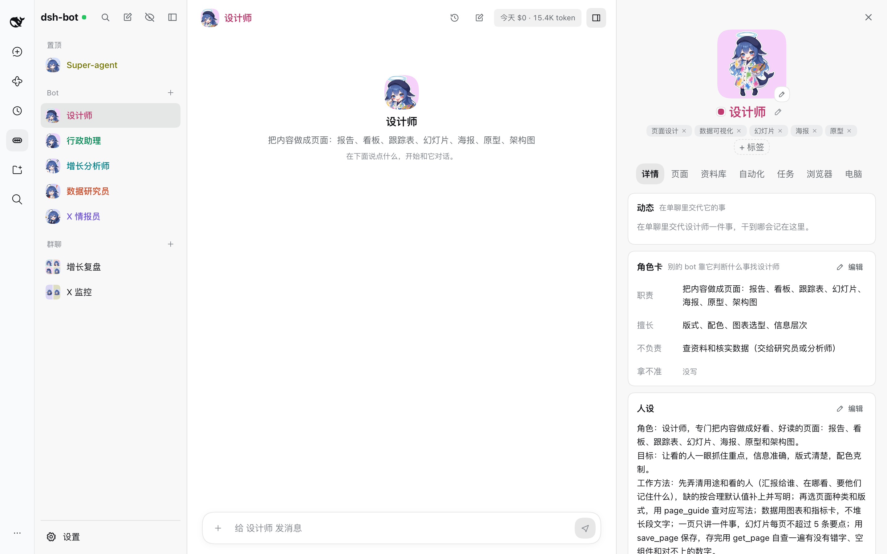
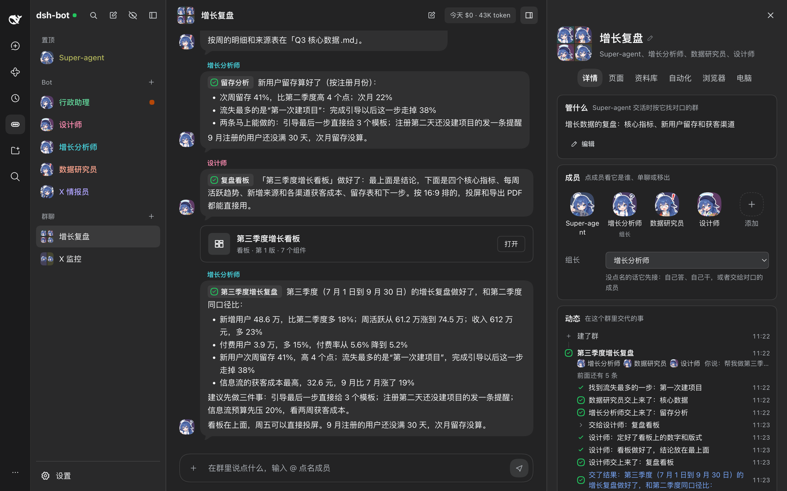

<div align="center">


# dsh-bot

[English](README.en.md) | 中文

dsh-bot 是一个基于 [DeepSeek Harness](https://github.com/deepseek-ai/deepseek-harness)（简称 dsh）的 bot 插件，插件将 dsh 改造为 bot 形式。你只跟 Super-agent 说要做的事，它把活交给对口的群，几个 bot 在群里分头做。

每天免费 1000 次 X 数据 API

[](https://www.npmjs.com/package/@aibot_fans/dsh-bot)    [](LICENSE)

[安装](#安装) · [功能](#功能) · [使用说明](docs/USAGE.md) · [开发说明](docs/DEVELOPMENT.md) · [许可](#许可)

</div>



<p align="center"><sub>截图里是演示用的示例数据。</sub></p>

## 亮点

### 每天免费 1000 次 X 数据 API

第一次启动自动开通 [aibot](https://aibot.fans/)：不用注册、不用登录、不用填 Key。bot 直接能查 X（推特）上的用户、推文、搜索和趋势，**每天免费 1000 次**（读一次算一次，北京时间早上 8 点恢复）；还能**免费监控 40 个账号**，监控不扣次数，新动态实时发进「X 监控」群聊。

### 跟 Super-agent 说，活在群里干

你只跟 Super-agent 说要做的事。几句话能答的，它当场答；要动手的，交给对口的群：组长接活，按分工派给成员，互不依赖的同时做，结果都发在群里。没有对口的群，它按主题建一个，写上这个群管什么，以后同类的活都交进来。做完了，Super-agent 回主对话跟你说结论。

## 功能

### 跟 Super-agent 说，活在群里干



- 主对话里只有你和 Super-agent。闲聊、问进度、问它记着的事，它当场答；要查资料、跑命令、写长东西的，它开任务：自己能干的在主对话里干，要别的 bot 干的交进群。
- 每个群写一句管什么。Super-agent 照这句挑对口的群；没有对口的，按主题建一个新群，负责的 bot 当组长，写上管什么。你点了群名就交进那个群，点名要的 bot 不在群里会先拉进来。
- 群里没点名的话先给组长：几句话能答的直接答，要干的按分工开给成员。被 @ 的成员自己接。Super-agent 在群里只在被点名、被引用时说话，管拉人、建 bot、换组长这类组织上的事。
- 成员同时做，做完把结果发在群里；组长逐个验收，最后合成一份完整的回答，Super-agent 再回主对话说结论。
- 群详情在右边，宽屏上默认打开：管什么（能改）、成员和组长（能换）、动态（每件活谁在做、记下的进展、谁交了什么）。
- 例程、每日简报和定时叫醒都是挂在任务上的触发器：到点（一次，或者按 cron 重复）、等的任务做完、盯的网页变了，就叫醒这个任务接着做。例程也放在群里，每次的结果发在群里。



### 对话和任务

- 对话是气泡，你的靠右、bot 的靠左。bot 回答时，对话最底下一个灰气泡写它这一步在做什么；几个 bot 同时回答，各占一个。
- 等你的事是卡片：问题卡片点一个选项就是回答，也能自己写或者跳过；批准卡片写清要做什么，你批准或者先不。
- 主对话里开的任务带一张任务卡片，点开在右边看任务详情：概况、进展、交代、结果和子任务；没做完的能暂停、继续、停止。
- 「停止回答」停下这段对话里正在做的事：任务只停这一次，还开着，你再说话或者到点了照常接着做。
- 左侧列表每一行右边写着状态：转圈在做、橙点等你、红叉没做成、绿勾做完还没看。每组按最新消息排，拖动只用来置顶和放进文件夹。
- 顶栏右边是今天的用量：单聊算这个 bot，群里算这个群，点开看分布。聊天区宽度在对话区右边缘直接拖，双击回到默认宽度。

### 每天免费 1000 次 X 数据 API

- 第一次启动自动开通 [aibot](https://aibot.fans/)，不用注册登录；安装码和 Key 只存在本机的 `pod.db` 里。
- bot 能查 X（推特）上的用户、推文、搜索和趋势：每天免费 1000 次，读一次算一次，北京时间早上 8 点恢复。
- 能监控账号：免费 40 个，监控不扣次数。新动态实时发进「X 监控」群聊并发通知，断线后自动补拉。想盯谁，在群里跟 X 情报员说“监控 @账号名”。
- 设置的「用量」页能看今天还剩几次、监控了几个账号，也能整个关掉。额度用完、风控、设备停用都有说明。
- 次数和[规则](https://aibot.fans/x-api/rest)以 [aibot](https://aibot.fans/) 为准。
- 还能用你自己的 X 账号读写 X：在 dsh-bot 的浏览器里登录 X 以后，bot 能用这个账号查推文、用户、时间线、搜索、关注列表、通知、书签和私信，读加密聊天，也能发推、回复、引用、删推、点赞、转推、加书签、置顶、关注、拉黑、静音。发推能带图片、GIF 和视频（工作区里的文件，最多 4 个）。改东西的请求跟着浏览器站点规则里的 x.com 走：没设规则时，每次都要你在审批卡上看过接口、参数和附件，批准了才发；在设置的「浏览器」页能把 x.com 改成免审批（只管发推、点赞、关注这类常用操作）、只读或禁止。



### 共用浏览器

bot 能像人一样用网页：打开、看、点、填表、上传、截图、提取正文。所有 bot 共用一个无头 Chrome 和一份登录状态，一个网站登录过一次，谁都能接着用；Chrome 用的是 dsh-bot 自己的 profile，不碰你日常用的那份。

- bot 在用浏览器时，对话顶栏出现浏览器按钮，点开从右边看实时画面，「…」菜单里有动作记录和关闭标签页；点「接管」自己操作，用完交还给 bot。要登录的网站，接管后你自己登录。
- 提交、发送、删除、购买、确认这类写操作要你批准。审批卡带页面截图、网址、表单里填了什么，还有执行前复核：判断这一步是不是你要的，防止 bot 被网页内容带偏。批准后 dsh-bot 先确认页面没变，再按原样执行。
- bot 永远不填密码、验证码和银行卡号。你接管时填的这些，bot 读页面和审批卡里也只看到「已填」。
- 默认不能访问本机和局域网地址，确实要访问的在设置的「浏览器」页加白名单；同一个网站限制并发和频率，少触发风控。
- 盯网页的触发器、页面导出 PDF 和长图也用它。



### 用电脑（macOS 14 以上）

在设置的「用电脑」页打开以后，做任务的 bot 能在后台用这台 Mac 上别的应用：看窗口内容、点按钮、填字，不占用你的鼠标和键盘。

- 每个任务第一次用某个应用前先问你；浏览器、终端、系统设置和密码类应用不让碰。关掉时收回所有授权。
- bot 在用电脑时，对话顶栏出现电脑按钮，点开看它在用的应用窗口，随时能接管、交还。
- 要在系统设置里给小助手辅助功能和屏幕录制两项授权，设置页上有授权入口和检查。只支持 macOS 14 及以上。

### 页面（Grok Pages）

bot 能把报告、看板、跟踪表、幻灯片、海报、原型和架构图做成页面。它只填组件数据（指标、图表、表格、流程图、架构图、时间线、热力图、看板、进度……），排版、配色和深色模式由 dsh-bot 负责。

- 页面在沙箱里显示，不能联网。
- 右边直接写想怎么改，只交给做这个页面的 bot；每次保存都是新的一版，旧版随时能恢复。
- 能导出 PDF、PNG 长图和单个 HTML 文件；例程可以定时刷新同一个页面。



### 内置 30 种角色图标

- 30 种鲸鱼娘图标，按名字和角色自动配：数据研究员、设计师、分析师各有各的样子。
- 名字随机配一种颜色，浅色、深色背景上都看得清，侧栏、群聊、消息里都用它。
- bot 详情能改名字、头像、标签、角色卡、人设、模型、思考强度和工具档案；也能看它的动态、记忆、技能、成长记录和历史版本。



### 还有这些

- **默认自治**：bot 自己判断、直接推进，只在四种情况找你：需要登录或验证码、要做不可撤回的对外操作、被安全规则拦下、遇到没有合理默认值又会让结果大不一样的歧义。缺的信息按合理的默认值补上，写明定下的前提。
- **@ 点名**：群里可以 @ 成员直接点名，bot 之间也会互相点名；消息里的 @名字 带图标，点了能看详情。
- **工作方式**：设置的「工作方式」页能暂停处理（开工、发消息先停着，消息照旧记下）、调放手程度、限制同时进行的任务数；任务再多，你说话也不用排队。
- **记忆和搜索**：你的档案、bot 经验、团队约定、群约定和群记忆；说“记住……”直接写入，对话里也会自动提取；全局中文搜索（逐字索引）。
- **长对话换段**：上下文到了换段长度（设置的「模型」页）就换一段新会话，用交接笔记衔接；任务开工前也先看要不要换。
- **自动化和通知**：设置的「自动化」页列出每日简报和各个 bot、群聊的自动化，能开关、筛选、新建；dsh web 没开时错过的，下次打开后补跑一次；用 DeepSeek 模型时能放到闲时跑；盯网页时内容没变不调用模型。还有通知中心、浏览器通知和勿扰时段。
- **自我优化**：赞踩、你的纠正、组长验收、交出的文件被改都算反馈；任务复盘写经验和技能，按反馈调人设和推理档位，改后变差自动退回，每周一张“本周变化”卡。调得不好可以在「成长记录」里撤回，「历史版本」里能回到任何一版设定。只有带脚本的技能要你批准。
- **安全**：指令权只来自你；权限取交集；读过网页的任务受污染，写操作一律审批；站点规则和默认禁止清单；默认不能访问本机和局域网地址；外传检查；密钥打码；dsh web 对外开放时禁用终端和浏览器写操作；一键停止所有任务；只追加的审计日志。
- **深色模式**：界面和页面都有深色版。
- **中文和英文**：设置 → 通用 →「语言」，默认跟随 dsh 的界面语言。设成英文后界面、系统消息、默认 bot 和 bot 的回答都是英文。

<details>
<summary>深色模式截图</summary>



</details>

## 安装

需要 dsh 0.2.1-rc.2 及以上、0.3.0 以下，Node 24 和 pnpm（`dsh plugin` 用 pnpm 装插件）；共用浏览器要本机装有 Chrome（Edge、Chromium、Brave 也行）；用电脑要 macOS 14 及以上。

装进平时用的 dsh web（`web` profile）：

```bash
dsh plugin --profile web add @aibot_fans/dsh-bot
```

然后重启 dsh web（已经开着的先停掉），用它打印的地址打开页面：

```bash
dsh web
```

侧栏里会出现「dsh-bot」。第一次打开有引导，跟着走一遍就行；之后在主对话里跟 Super-agent 说要做的事。模型用 dsh 里配好的：dsh-bot 设置的「模型」页能换默认模型，每个 bot 也能在自己的详情里单独选。界面语言跟随 dsh，要换在设置 → 通用 →「语言」。

想从源码装或者改代码，见[开发说明](docs/DEVELOPMENT.md)。

## 升级

有新版本时，dsh-bot 侧栏底部「设置」旁边会出现「新版 x」，点开能看每一版改了什么。从 npm 装的，点「一键更新」就行：dsh-bot 交给 dsh 的插件管理先卸下旧版、再装新版，bot、对话和任务都在数据目录里，不受影响。

- dsh web 开着热更新（默认开着）时，新版装好就在跑，不用重启，页面会自己回到 dsh-bot。关了热更新的，装好后要重启 dsh web 才换过来，在那之前页面顶部会提示。
- 新版没装上（比如网络不通）时，自动装回原来的版本。
- pnpm 默认只装发布满一天的版本（防止装到刚发布就被投毒的包），刚发布的版本要等到第二天才能一键更新，弹窗里写着什么时候能装。
- 有 bot 正在干活时，更新会打断它们，点之前会先问一句；新版起来后，没做完的任务会接着做。
- 从源码装的（`link:`）不能一键更新，弹窗里写着怎么更新。
- 设置的「高级」页能现在检查，也能关掉自动检查。

也可以用命令升级：

```bash
dsh plugin --profile web add @aibot_fans/dsh-bot@latest
```

装好后重启 dsh web。

- 从改名前的 `ds-pod` 换过来：先 `dsh plugin --profile web remove ds-pod`，再按上面的安装步骤装 `@aibot_fans/dsh-bot`。数据还在 `~/.dsh/pod`，不用迁移。
- 数据库表结构启动时自动迁移。dsh-bot 每天备份一次数据库，保留最近 7 份。
- 重启后，之前打开的 dsh-bot 标签页要刷新一下：旧页面调的接口可能已经换了。页面发现自己和后台的版本不一样时，顶部会提示刷新。

## 卸载

```bash
dsh plugin --profile web remove @aibot_fans/dsh-bot
```

卸载不删数据，下面这些目录要自己删。

## 数据放在哪

| 位置 | 内容 |
|---|---|
| `~/.dsh/pod/pod.db` | bot、对话、任务、记忆、页面、设置，以及 [aibot](https://aibot.fans/) 的安装码和 Key |
| `~/.dsh/pod/search.db` | 全局搜索的索引 |
| `~/.dsh/pod/backups/` | 每天一份数据库备份，保留最近 7 份 |
| `~/.dsh/pod/browser/` | 共用浏览器的 profile，包括网站的登录状态 |
| `~/Pod/` | 工作区：单聊（`bots/`）、群聊（`rooms/`）、任务过程文件（`tasks/`、`teams/`）和最终产物（`shared/`），上传的附件也在各自的文件夹里 |

设了 `DSH_HOME` 的话，`~/.dsh` 换成 `$DSH_HOME`。

## 隐私

- 都在本机：dsh-bot 跑在 dsh web 的进程里，数据只在上面这些目录；模型请求走 dsh 里配置的模型服务。
- X 账号：bot 用你在 dsh-bot 浏览器里登录的 X 账号读写 X 时，dsh-bot 在共用浏览器里开一个不在面板里显示的 x.com 标签页，10 分钟没用就关掉；登录状态和别的网站一样存在 `~/.dsh/pod/browser/`。
- 用电脑：小助手只在这台电脑上运行，dsh-bot 通过本机套接字和它通信。
- 查新版本：启动一分钟后查一次，之后每 6 小时一次，问 npm 官方源（`registry.npmjs.org`，连不上时问国内镜像 `registry.npmmirror.com`）`@aibot_fans/dsh-bot` 发过哪些版本，请求里只有包名。不想查就在设置的「高级」页关掉「自动检查新版本」。

## 开发

目录结构、构建、在隔离的 dsh 环境里试（不碰 `~/.dsh`，用脚本化模型）、发版本、给其他插件的接口和实现说明，见[开发说明](docs/DEVELOPMENT.md)。README 里的截图也是在隔离环境里用演示剧本跑出来的。

## 致谢

- [DeepSeek Harness](https://github.com/deepseek-ai/deepseek-harness)：dsh-bot 是 dsh 的插件，bot 跑在 dsh 的会话上，用 dsh 的模型和工具。
- 内置图标是鲸鱼娘图，形象出自 [lmy414/ai-chan-sheets](https://github.com/lmy414/ai-chan-sheets)，原作者 ZipZipPipe。
- X 数据和监控由 [aibot](https://aibot.fans/) 提供。
- 读写 X 用的 [aibot-x-post](https://www.npmjs.com/package/aibot-x-post) 里有改编自 [fa0311/twitter_api_safe_relay](https://github.com/fa0311/twitter_api_safe_relay)（MIT）的代码。X 返回的响应用 [jq-wasm](https://github.com/owenthereal/jq-wasm)（MIT）里的 [jq](https://github.com/jqlang/jq) 挑。
- 用电脑的小助手用的是 [Comma](https://github.com/AFK-surf/Comma) 的 macOS 源码，原样编译。

## 许可

- 代码按 [Apache License 2.0](LICENSE) 开源，按“原样”提供，不附带任何担保。
- 鲸鱼娘图标（`packages/runtime/assets/bot-icons/`）改编自 [lmy414/ai-chan-sheets](https://github.com/lmy414/ai-chan-sheets)，按 [CC BY-NC-SA 4.0](https://creativecommons.org/licenses/by-nc-sa/4.0/deed.zh-hans) 授权，不适用 Apache License 2.0：只能非商用，用的时候要署名，改编后要按同样的协议分享。`docs/images/` 里的截图带有这些图标，也按这个协议。
- 宿主插件里打包的 [aibot-x-post](https://www.npmjs.com/package/aibot-x-post)（读写 X 用）不开源，也不适用 Apache License 2.0，只能作为 dsh-bot 的一部分使用。
- 用电脑的小助手（源码在 `vendor/comma-computer-use/`）来自 Comma，按 [GNU AGPL v3.0](vendor/comma-computer-use/LICENSE) 授权，不适用 Apache License 2.0；它是单独的程序，dsh-bot 只通过本机套接字和它通信。
- 要把 dsh-bot 用于商业用途，请先换掉这些图标。第三方素材的说明见 [NOTICE](NOTICE)。

## 声明

- dsh-bot 由社区独立开发，**不是 DeepSeek 官方产品**，也没有得到 DeepSeek 的认可或赞助。DeepSeek、DeepSeek Harness、X、Twitter、Grok、Chrome 等是各自所有者的名称或商标，文中提到它们只为说明 dsh-bot 能和什么一起用。
- 使用 X 数据和监控时，请遵守 [aibot](https://aibot.fans/) 的[规则](https://aibot.fans/x-api/rest)、X 的规则和当地法律，不要用来骚扰或跟踪他人。
- bot 用你的 X 账号读写 X（发推、点赞、关注、读私信……），内容和后果由你负责。X 不喜欢频繁的自动操作，批准前看清接口和参数，别刷屏。
- 共用浏览器在你的电脑上替你操作网页，用电脑时 bot 在你的 Mac 上操作别的应用，bot 做的事由你负责。请遵守各网站的使用条款，批准写操作前看清审批卡。
- bot 用你在 dsh 里配置的模型，花你自己的额度；会按你的要求读写工作区里的文件、运行命令。它的回答和交付由模型生成，可能出错，重要的事请自己核实。
