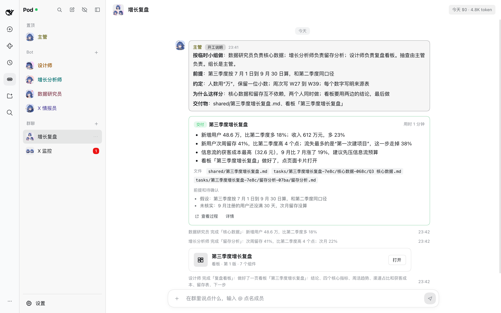
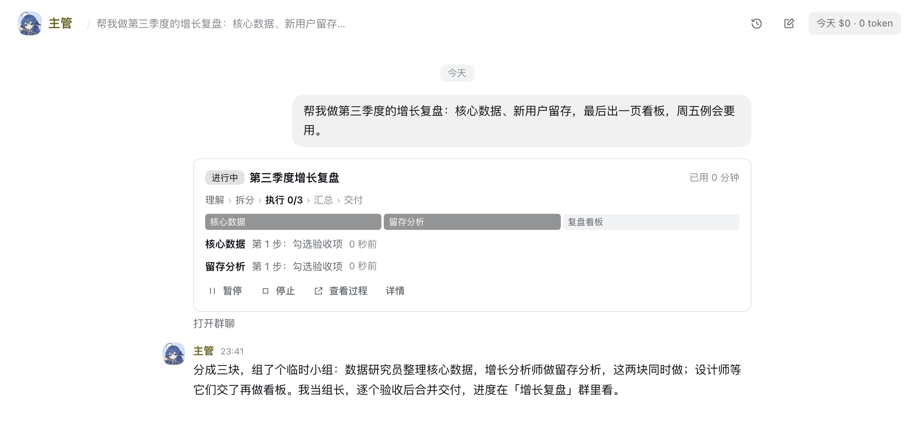
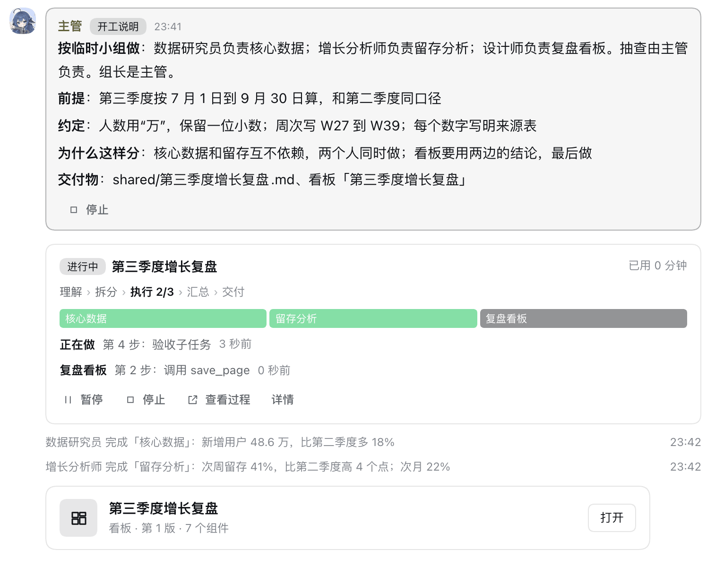
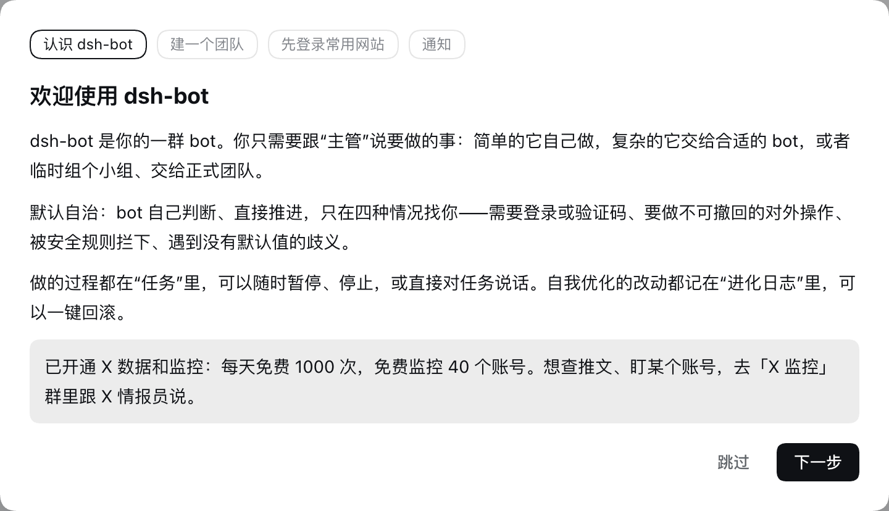
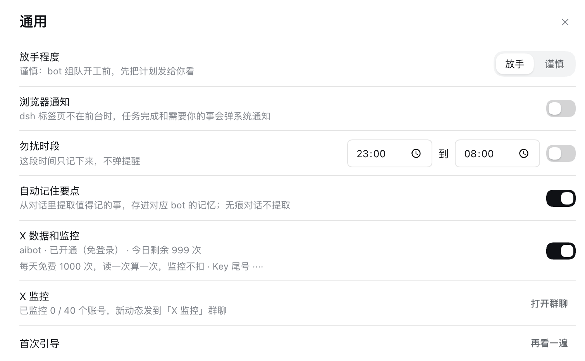
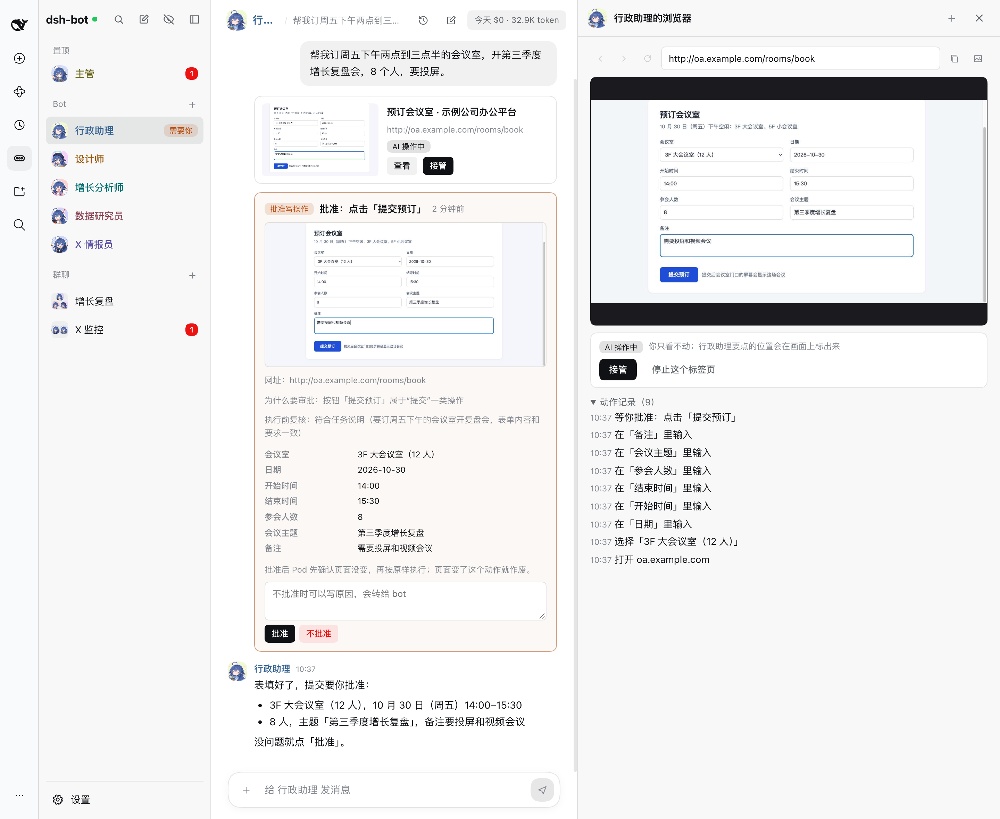
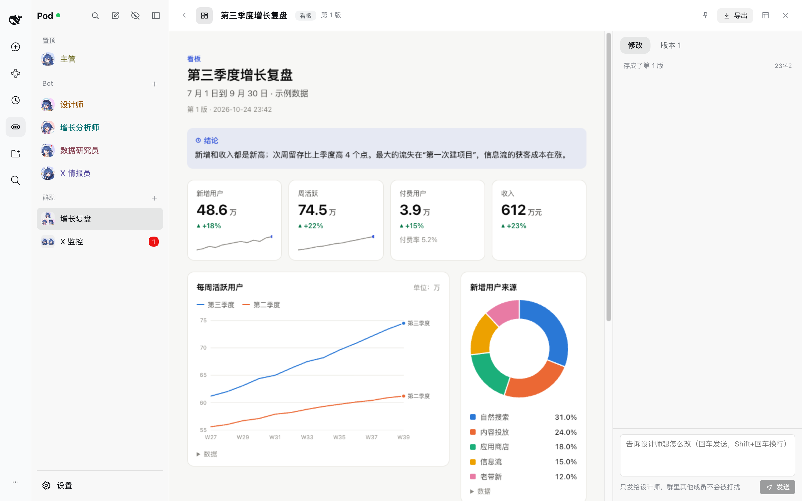
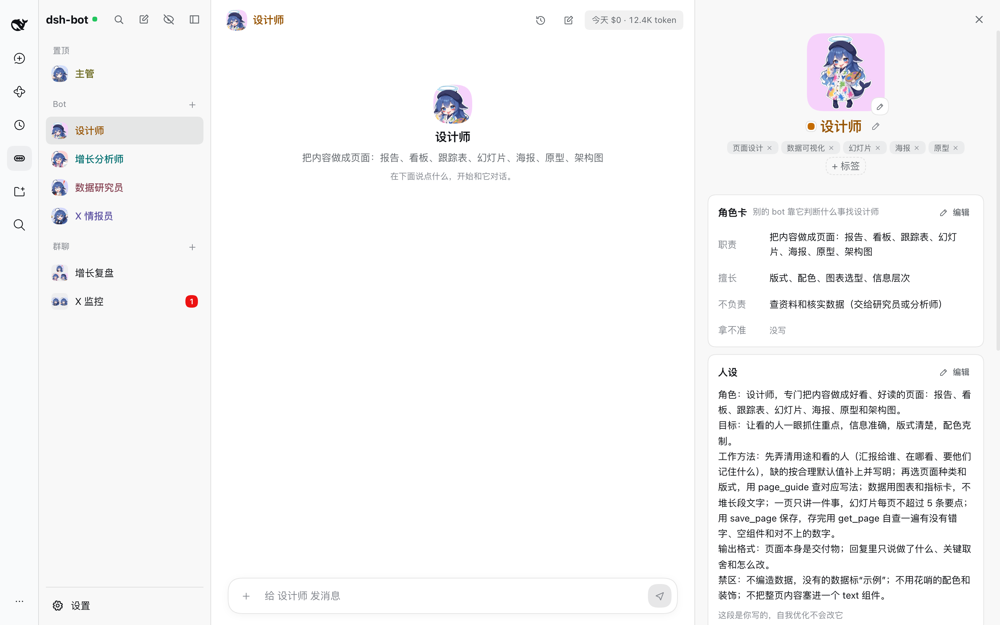
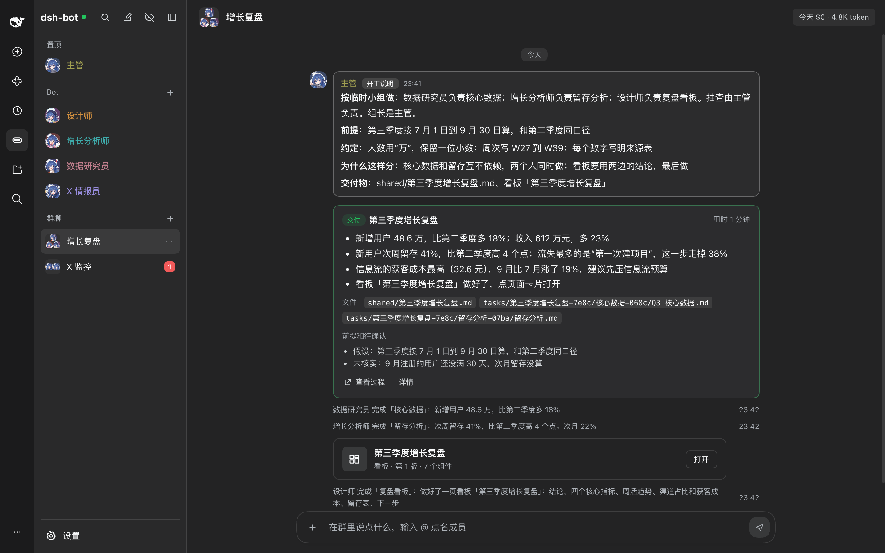

<div align="center">


# dsh-bot

dsh-bot（原名 DeepSeek Pod，界面里简称 Pod）是一个基于 [DeepSeek Harness](https://github.com/deepseek-ai/deepseek-harness)（简称 dsh）的 bot 插件，插件将 dsh 改造为 bot 形式。每个任务都是一个团队。

每天免费 1000 次 X 数据 API

[](https://www.npmjs.com/package/@aibot_fans/dsh-bot)    [](LICENSE)

[安装](#安装) · [功能](#功能) · [使用说明](docs/USAGE.md) · [开发说明](docs/DEVELOPMENT.md) · [许可](#许可)

</div>



<p align="center"><sub>截图里是演示用的示例数据。</sub></p>

## 亮点

### 每天免费 1000 次 X 数据 API

第一次启动自动开通 [aibot](https://aibot.fans/)：不用注册、不用登录、不用填 Key。bot 直接能查 X（推特）上的用户、推文、搜索和趋势，**每天免费 1000 次**（读一次算一次，北京时间早上 8 点恢复）；还能**免费监控 40 个账号**，监控不扣次数，新动态实时发进「X 监控」群聊。

### 每个任务都是一个团队

你只跟主管说要做的事。简单的它自己做；复杂的当场组队：拆成子任务，按能力分给合适的 bot，互不依赖的同时做。每个任务开一个群专门推进，任务卡实时显示谁在做什么；组长逐个验收、打回、汇总，最后交一张交付卡：要点、文件、前提和待确认。

## 功能

### 每个任务都是一个团队

跟主管说一句要做什么，它判断怎么做：自己做（L0）、交给一个 bot（L1）、临时组个小组、主管兼组长（L2），或者交给正式团队、由组长负责（L3）。



- 计划先校验再开工。分工、前提、任务约定和为什么这样分写成开工说明，发在任务的群里。
- 按依赖调度，互不依赖的子任务同时做。任务卡原地刷新：阶段、分段进度条、每个成员正在做什么、花费。
- 组长逐个验收，不合格就打回；成员卡住了就换做法、换人或拆小；需求变了出新版计划，只重做受影响的部分。
- 全部通过后合并结果，任务卡变成交付卡：要点、文件（点开就能预览）、前提和待确认。过程中随时可以暂停、停止、继续，或者直接对任务说话。



### 每天免费 1000 次 X 数据 API

- 第一次启动自动开通 [aibot](https://aibot.fans/)，不用注册登录；安装码和 Key 只存在本机的 `pod.db` 里。
- bot 能查 X（推特）上的用户、推文、搜索和趋势：每天免费 1000 次，读一次算一次，北京时间早上 8 点恢复。
- 能监控账号：免费 40 个，监控不扣次数。新动态实时发进「X 监控」群聊并发通知，断线后自动补拉。想盯谁，在群里跟 X 情报员说“监控 @账号名”。
- 设置「通用」页能看今天还剩几次、监控了几个账号，也能整个关掉。额度用完、风控、设备停用都有中文说明。
- 次数和[规则](https://aibot.fans/x-api/rest)以 [aibot](https://aibot.fans/) 为准。

<p>


</p>

### 共用浏览器

bot 能像人一样用网页：打开、看、点、填表、上传、截图、提取正文。所有 bot 共用一个无头 Chrome 和一份登录状态，一个网站登录过一次，谁都能接着用；Chrome 用的是 Pod 自己的 profile，不碰你日常用的那份。

- bot 打开网页时，对话里出现浏览器卡片。点「查看」从右侧看实时画面和动作记录；点「接管」自己操作，用完交还给 bot。要登录的网站，接管后你自己登录。
- 提交、发送、删除、购买、确认这类写操作要你批准。审批卡带页面截图、网址、表单里填了什么，还有执行前复核：判断这一步是不是你要的，防止 bot 被网页内容带偏。批准后 Pod 先确认页面没变，再按原样执行。
- bot 永远不填密码、验证码和银行卡号。你接管时填的这些，bot 读页面和审批卡里也只看到「已填」。
- 默认不能访问本机和局域网地址，确实要访问的在设置「浏览器」页加白名单；同一个网站限制并发和频率，少触发风控。
- 盯网页的例程、页面导出 PDF 和长图也用它。



### 页面（Grok Pages）

bot 能把报告、看板、跟踪表、幻灯片、海报、原型和架构图做成页面。它只填组件数据（指标、图表、表格、流程图、架构图、时间线、热力图、看板、进度……），排版、配色和深色模式由 Pod 负责。

- 页面在沙箱里显示，不能联网。
- 右边直接写想怎么改，只交给做这个页面的 bot；每次保存都是新的一版，旧版随时能恢复。
- 能导出 PDF、PNG 长图和单个 HTML 文件；例程可以定时刷新同一个页面。



### 内置30多种角色图标

- 30 种鲸鱼娘图标，按名字和角色自动配：数据研究员、设计师、分析师各有各的样子。
- 名字随机配一种颜色，浅色、深色背景上都看得清，侧栏、群聊、消息里都用它。
- bot 详情能改全部设定：名字、角色、头像、能力标签、角色卡、人设、模型、思考强度、工具档案；也能看记忆、技能、成长记录和历史版本。



### 还有这些

- **默认自治**：bot 自己判断、直接推进，只在四种情况找你：需要登录或验证码、要做不可撤回的对外操作、被安全规则拦下、遇到没有默认值的歧义。能绕过的先绕过，交付时写明前提和待确认。
- **群聊**：群里可以 @ 成员直接点名，bot 之间也会互相点名；消息里的 @名字 带图标，点了能看详情。
- **记忆和搜索**：你的档案、bot 经验、团队约定、群约定和群记忆；说“记住……”直接写入，对话里也会自动提取；全局中文搜索（逐字索引）。
- **长对话换段**：上下文接近软上限时换一段新会话，用交接笔记衔接。
- **例程和通知**：定时例程（cron、补跑、错峰）、盯网页（内容没变不调用模型）、每日简报、通知中心和浏览器通知、勿扰。
- **自我优化**：赞踩、你的纠正、组长验收、交付后被改都算反馈；任务复盘写经验和技能，按反馈调人设和推理档位，改后变差自动退回，每周一张“本周变化”卡。调得不好可以在「成长记录」里撤回，「历史版本」里能回到任何一版设定。只有带脚本的技能要你批准。
- **安全**：指令权只来自你；权限取交集；读过网页的任务受污染，写操作一律审批；站点规则和默认禁止清单；默认不能访问本机和局域网地址；外传检查；密钥打码；dsh web 对外开放时禁用终端和浏览器写操作；一键停止；只追加的审计日志。
- **深色模式**：界面和页面都有深色版。

<details>
<summary>深色模式截图</summary>



</details>

## 安装

需要 dsh 0.2.1-rc.2 及以上、0.3.0 以下，Node 24 和 pnpm（`dsh plugin` 用 pnpm 装插件）；共用浏览器要本机装有 Chrome（Edge、Chromium、Brave 也行）。

装进平时用的 dsh web（`web` profile）：

```bash
dsh plugin --profile web add @aibot_fans/dsh-bot
```

然后重启 dsh web（已经开着的先停掉），用它打印的地址打开页面：

```bash
dsh web
```

侧栏里会出现「dsh-bot」。第一次打开有引导，跟着走一遍就行；之后直接跟主管说要做的事。模型用 dsh 里配好的：Pod 设置的「模型」页能换默认模型，每个 bot 也能在自己的详情里单独选。

想从源码装或者改代码，见[开发说明](docs/DEVELOPMENT.md)。

## 升级

```bash
dsh plugin --profile web add @aibot_fans/dsh-bot@latest
```

装好后重启 dsh web。

- 从改名前的 `ds-pod` 换过来：先 `dsh plugin --profile web remove ds-pod`，再按上面的安装步骤装 `@aibot_fans/dsh-bot`。数据还在 `~/.dsh/pod`，不用迁移。
- 数据库表结构启动时自动迁移。Pod 每天备份一次数据库，保留最近 7 份。
- 重启后，之前打开的 Pod 标签页要刷新一下：旧页面调的接口可能已经换了。页面发现自己和 Pod 的版本不一样时，顶部会提示刷新。

## 卸载

```bash
dsh plugin --profile web remove @aibot_fans/dsh-bot
```

卸载不删数据，下面这些目录要自己删。

## 数据放在哪

| 位置 | 内容 |
|---|---|
| `~/.dsh/pod/pod.db` | bot、对话、任务、记忆、页面、设置，以及 [aibot](https://aibot.fans/) 的安装码和 Key |
| `~/.dsh/pod/search.db` | 全局搜索的索引 |
| `~/.dsh/pod/backups/` | 每天一份数据库备份，保留最近 7 份 |
| `~/.dsh/pod/browser/` | 共用浏览器的 profile，包括网站的登录状态 |
| `~/Pod/` | 工作区：单聊（`bots/`）、群聊（`rooms/`）、任务过程文件（`tasks/`、`teams/`）和最终产物（`shared/`），上传的附件也在各自的文件夹里 |

设了 `DSH_HOME` 的话，`~/.dsh` 换成 `$DSH_HOME`。

## 隐私

- 都在本机：Pod 跑在 dsh web 的进程里，数据只在上面这些目录；模型请求走 dsh 里配置的模型服务。

## 开发

目录结构、构建、在隔离的 dsh 环境里试（不碰 `~/.dsh`，用脚本化模型）、发版本、给其他插件的接口和实现说明，见[开发说明](docs/DEVELOPMENT.md)。README 里的截图也是在隔离环境里用演示剧本跑出来的。

## 致谢

- [DeepSeek Harness](https://github.com/deepseek-ai/deepseek-harness)：Pod 是 dsh 的插件，bot 跑在 dsh 的会话上，用 dsh 的模型和工具。
- 内置图标是鲸鱼娘图，形象出自 [lmy414/ai-chan-sheets](https://github.com/lmy414/ai-chan-sheets)，原作者 ZipZipPipe。
- X 数据和监控由 [aibot](https://aibot.fans/) 提供。

## 许可

- 代码按 [Apache License 2.0](LICENSE) 开源，按“原样”提供，不附带任何担保。
- 鲸鱼娘图标（`packages/runtime/assets/bot-icons/`）改编自 [lmy414/ai-chan-sheets](https://github.com/lmy414/ai-chan-sheets)，按 [CC BY-NC-SA 4.0](https://creativecommons.org/licenses/by-nc-sa/4.0/deed.zh-hans) 授权，不适用 Apache License 2.0：只能非商用，用的时候要署名，改编后要按同样的协议分享。`docs/images/` 里的截图带有这些图标，也按这个协议。
- 要把 Pod 用于商业用途，请先换掉这些图标。第三方素材的说明见 [NOTICE](NOTICE)。

## 声明

- dsh-bot 由社区独立开发，**不是 DeepSeek 官方产品**，也没有得到 DeepSeek 的认可或赞助。DeepSeek、DeepSeek Harness、X、Twitter、Grok、Chrome 等是各自所有者的名称或商标，文中提到它们只为说明 Pod 能和什么一起用。
- 使用 X 数据和监控时，请遵守 [aibot](https://aibot.fans/) 的[规则](https://aibot.fans/x-api/rest)、X 的规则和当地法律，不要用来骚扰或跟踪他人。
- 共用浏览器在你的电脑上替你操作网页，bot 在网站上做的事由你负责。请遵守各网站的使用条款，批准写操作前看清审批卡。
- bot 用你在 dsh 里配置的模型，花你自己的额度；会按你的要求读写工作区里的文件、运行命令。它的回答和交付由模型生成，可能出错，重要的事请自己核实。
